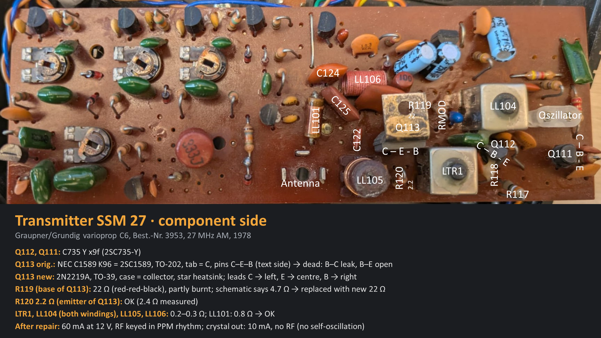
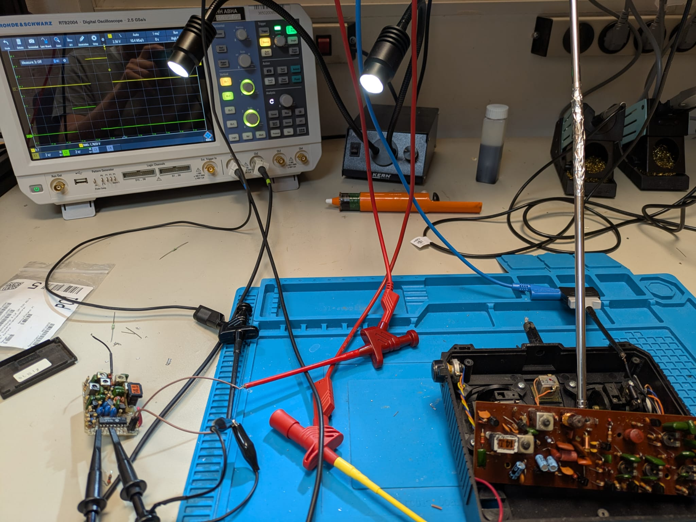
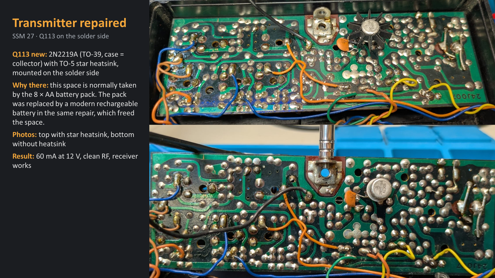
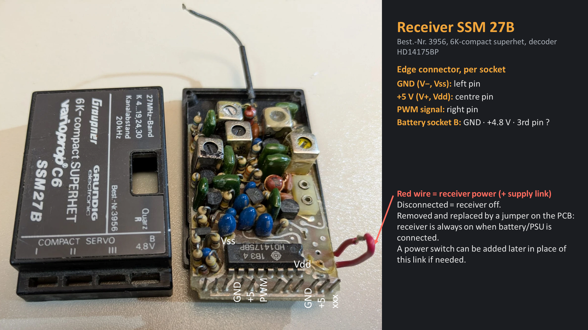
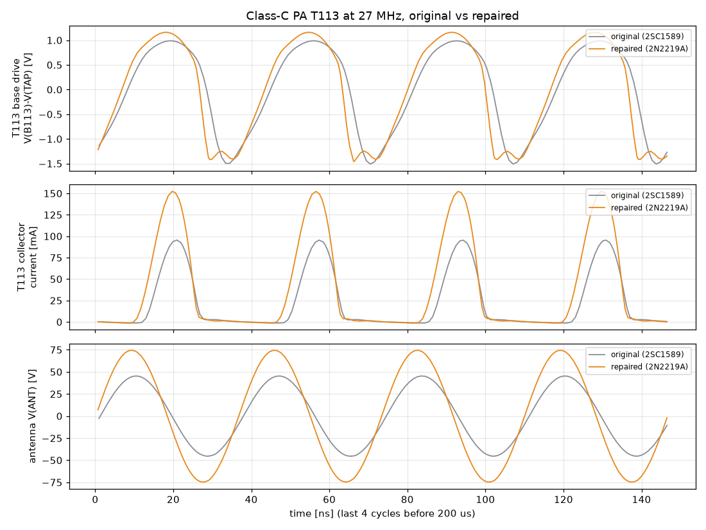

# varioprop-c6-repair

Repair and LTspice simulation of a **Graupner/Grundig varioprop C6 SSM 27** RC transmitter
(Best.-Nr. 3953, 27 MHz AM, 1978) and test with its **SSM 27B** receiver (Best.-Nr. 3956).

## Result
| | |
|---|---|
| Fault | T113, RF power amp **NEC 2SC1589** dead: B–C ≈ 200 Ω resistive leak, B–E junction open |
| Likely cause | B–E reverse breakdown (V_EBO only 4 V) – overdrive or operation without antenna |
| Fix | **2N2219A** (TO-39, case = collector) with TO-5 star heatsink; R119 replaced with a new **22 Ω** (original value; schematic says 4.7 Ω) |
| Preventive | 3 × supply elkos 4.7 µF / 25 V → 10 µF / 25 V |
| After repair | 60 mA at 12 V, clean 27 MHz carrier keyed in PPM rhythm, crystal out → 10 mA / no RF (no self-oscillation), receiver works, servo outputs follow the sticks |

Full step-by-step log with every reading: [docs/MEASUREMENTS.md](docs/MEASUREMENTS.md).

## Contents
| Path | What |
|---|---|
| [docs/MEASUREMENTS.md](docs/MEASUREMENTS.md) | measurement and repair log with photos: inspection, diode tests, replacement, power-up, receiver test, fault-finding guide |
| [docs/datasheets/2SC1589.md](docs/datasheets/2SC1589.md) | datasheet for the 2SC1589 (no original NEC sheet found), substitutes, estimated SPICE model |
| [docs/datasheets/DATASHEETS.md](docs/datasheets/DATASHEETS.md) | parts on the boards (2SC1589, 2SC735, 2SC945, HD14175BP) with links |
| [docs/SOURCES.md](docs/SOURCES.md) | where the schematic and other info come from |
| [docs/images/](docs/images/) | annotated slides `tx_component_side.png`, `tx_solder_side.png`, `rx_ssm27b.png`, `tx_repaired.png` (source deck `annotated_boards.pptx`); photos `tx_solder_side_heatsink.jpeg`, `tx_solder_side_no_heatsink.jpeg`, `tx_open_in_case.jpeg`, `bench_setup.jpeg` |
| [sim/](sim/README.md) | **LTspice model of the TX RF section** (regulator, crystal oscillator T111, driver T112, class-C PA T113, pi network, antenna model), results and plots |
| [sim/varioprop_c6_ssm27_original.asc](sim/varioprop_c6_ssm27_original.asc) | before the repair: T113 = 2SC1589 (estimated model) |
| [sim/varioprop_c6_ssm27_repaired.asc](sim/varioprop_c6_ssm27_repaired.asc) | after the repair: T113 = 2N2219A |
| [sim/make_plots.py](sim/make_plots.py) | runs both in LTspice, writes the comparison plots |

## Simulation notes
- Open either `.asc` in `sim/` in LTspice and run (`.tran`, `.meas` for current, output power, T113 dissipation), or run `python sim/make_plots.py` for both.
- For comparing original and repaired, not for absolute values: coder and keying are not modelled; coils, crystal and antenna are **assumed**. Details in [sim/README.md](sim/README.md).

## Not included
The original schematic (redraw JMF 09/13, rc-network wiki) and the manufacturer datasheets are third-party material
and are not included – see [docs/SOURCES.md](docs/SOURCES.md) and [docs/datasheets/DATASHEETS.md](docs/datasheets/DATASHEETS.md) for links.

## Safety
Operating a 27 MHz transmitter is subject to local radio regulations. Never power the transmitter without antenna
or dummy load – that is the most likely way the original output transistor died.

## License
[CC BY 4.0](LICENSE) – free to share and adapt with attribution.
