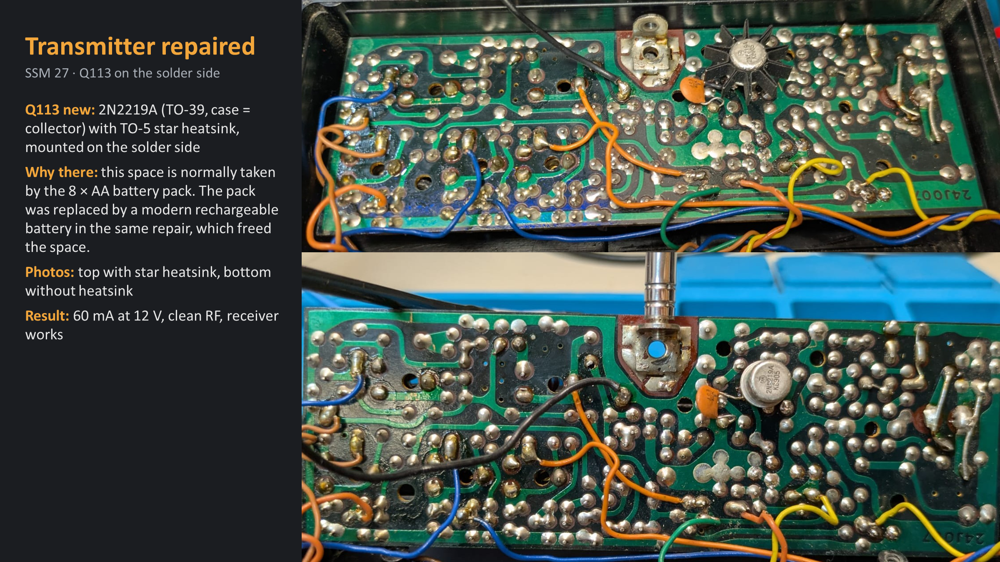
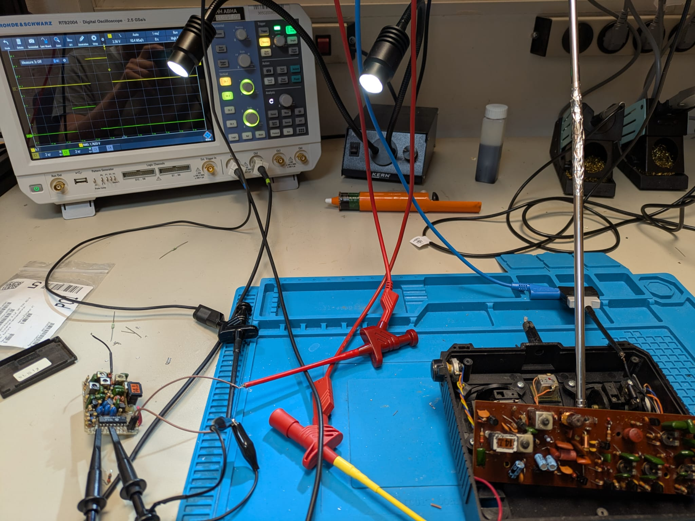
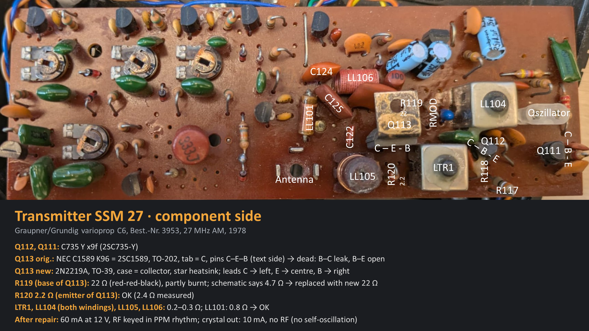
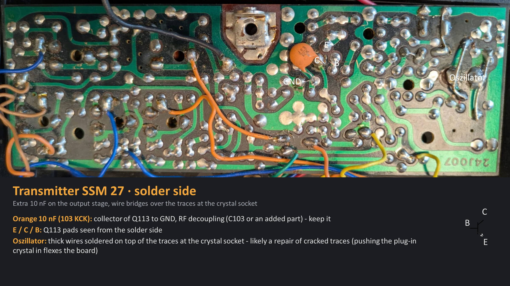
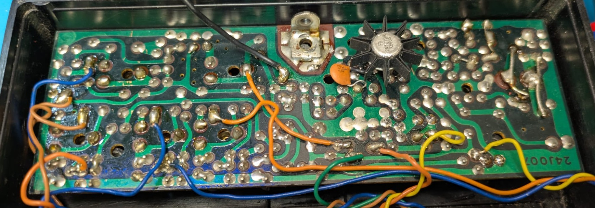
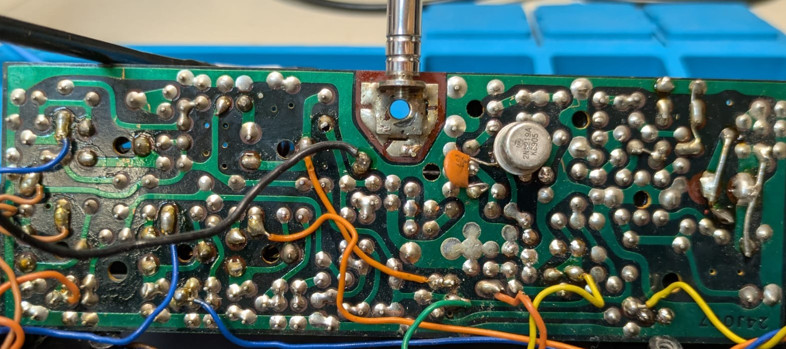
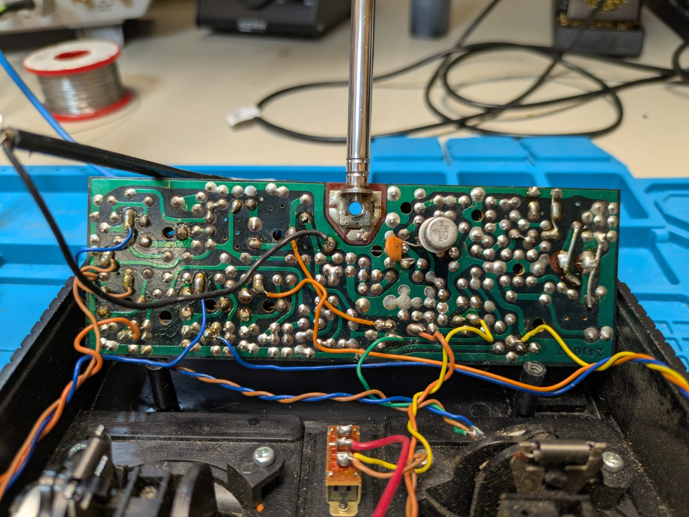
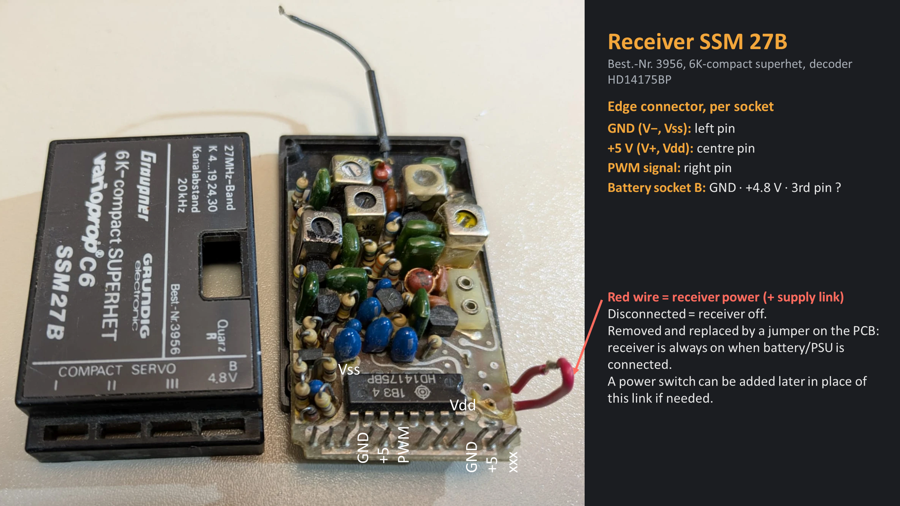

# Measurements and repair log

Graupner/Grundig varioprop C6, transmitter **SSM 27** (Best.-Nr. 3953) and receiver **SSM 27B** (Best.-Nr. 3956).
Bench work on 2026-11-24 and 2026-11-25.

## Summary

| Step | Finding |
|---|---|
| Symptom | output transistor T113 got hot, resistor next to it darkened |
| Fault | **T113 (NEC 2SC1589) dead**: B–C ≈ 200 Ω resistive leak, B–E junction open |
| Not faulty | R120, all coils and transformers, supply path |
| R119 | deviates from the [schematic](https://wiki.rc-network.de/wiki/Graupner_Fernsteuersender_%C3%9Cbersicht#Varioprop_C6) (4.7 Ω): partly burnt, colour code red-red-black = **22 Ω**, matches the measurement → replaced with a new 22 Ω on the board and set to 22 Ω in the simulation |
| Fix | **2N2219A** with TO-5 star heatsink, mounted on the solder side; R119 replaced with a new 22 Ω |
| Preventive | 3 supply elkos 4.7 µF / 25 V → 10 µF / 25 V |
| Result | 60 mA at 12 V, clean 27 MHz carrier keyed in PPM rhythm, no self-oscillation, receiver works |

## Conventions and equipment

- Multimeter
- Bench supply with current limit (12 V / 150 mA for the TX, 5 V / 50 mA for the RX).
- Oscilloscope, ×10 probe, short ground lead.
- T113 pins, looking at the text side of the original part: **left = C (tab), centre = E, right = B**.

## 1. Board and visual inspection

| Item | Finding | Verdict |
|---|---|---|
| Electrolytics, crystal, board | no bulging, no visible damage | OK |
| T113 area | T113 got hot, R119 next to it partly burnt | suspect |
| Transistor markings | T113 `NEC C1589 K96` (2SC1589, TO-202); T111/T112 `C735 Y` (2SC735-Y); others `C945` (2SC945) | see [datasheets](datasheets/DATASHEETS.md) |
| Extra 10 nF (`103 KCK`) on the solder side | from T113 collector to GND | RF decoupling, keep |
| Thick wires at the crystal socket (solder side) | soldered on top of the existing traces | likely repair of cracked traces, see section 9 |

## 2. Passive checks (battery out, all parts in circuit)

| Item | Value | Verdict |
|---|---|---|
| VBAT to GND | ≈ 200 Ω | later explained by the T113 leak (section 3) |
| Tr1, both windings | ≈ 0.2 Ω each | OK |
| L104 (both windings) | ≈ 0.2 Ω | OK |
| L105 (tapped) | ≈ 0.2–0.3 Ω | OK |
| L106 | ≈ 0.2 Ω | OK |
| L101 (antenna loading coil) | ≈ 0.8 Ω | OK |
| T113 tab ↔ left pin | continuity | tab = collector |
| R120 (emitter, centre pin) | 2.4 Ω (2.2 Ω nominal) | OK |

## 3. Finding the fault in T113

### 3.1 T113 in circuit, R119 fitted
In-circuit diode readings on T113 are not conclusive: B–E is bridged by R119, L104 and L105.

| Measurement | Value |
|---|---|
| right (B) → centre (E), diode | 0.028 V, beeps (≈ 22 Ω path via R119 / L104 / L105) |
| right → left, left → right, centre → right, diode | ≈ 0.2 V |
| right (B) → GND | 22 Ω, beeps |
| left (C) → GND | ≈ 200 Ω |
| centre (E) → GND | 2.6 Ω, beeps |

### 3.2 R119 removed T113 still fitted (base isolated)

| Measurement | Value | Healthy NPN |
|---|---|---|
| R119 out of circuit | 22 Ω, bands red-red-black | – |
| B → E, diode | 1.8 V | 0.6–0.75 V |
| B → C, diode | 0.2 V | 0.6–0.75 V |
| E → B, diode | 1.3 V | OL |
| B → GND, ohms | 10.1 kΩ | kΩ (forward junction) |
| GND → B, ohms (probes swapped) | 57 kΩ | OL / MΩ |

**R119 deviates from the [schematic](https://wiki.rc-network.de/wiki/Graupner_Fernsteuersender_%C3%9Cbersicht#Varioprop_C6)** (4.7 Ω there). The part is partly burnt, but the colour code (red-red-black) still reads **22 Ω**, matching the measurement – so the schematic is either a redraw error or a factory change. R119 was **replaced with a new 22 Ω** on the board, and the simulation was changed to 22 Ω.

### 3.3 Old T113 out of circuit

| Red → Black, diode | Value | Healthy NPN | Verdict |
|---|---|---|---|
| B → E | 3.1 V | 0.6–0.75 V | B–E junction destroyed |
| B → C | 0.19 V | 0.6–0.75 V | B–C leak ≈ 200 Ω |
| E → B | 1.4 V | OL | leaky |
| C → B | 0.19 V | OL | B–C conducts both ways = resistive short |
| C → E | 3.39 V | OL | leak path C → B → E |
| E → C | OL | OL | OK |

**Result: T113 is defective.** The in-circuit "C to GND ≈ 200 Ω" came from this leak
(C → B → R119 → L104 → L105 → GND).
Likely cause: B–E reverse breakdown (V_EBO of the 2SC1589 is only 4 V) from overdrive or operation without antenna.

## 4. Empty T113 pads (battery out)

| Pad | To | Value | Verdict |
|---|---|---|---|
| left (C) | V+ (switch on) | 0.4 Ω | L102 and supply path OK |
| left (C) | GND | 7 kΩ | OK (the 200 Ω was the leaky T113) |
| centre (E) | GND | 2.4 Ω | R120 + L105 OK |
| right (B) | GND | OL | OK, R119 out |
| left ↔ centre | – | ≈ 1 MΩ | C121 (22 pF) not shorted |

## 5. Replacement: 2N2219A

| Item | Value |
|---|---|
| Part | 2N2219A, TO-39 metal can, **case = collector** |
| Why | V_CEO 50 V, V_EBO 6 V, 0.8 A, f_T ≥ 250 MHz – more robust than the original; i already have it |
| Pinout (bottom view) | 1 = E (next to the tab), 2 = B, 3 = C |
| Fitting | C → left hole, E → centre hole, B → right hole; short leads, sleeved where they cross |
| Position | on the solder side; the space is free because the 8 × AA pack was replaced by a modern rechargeable battery |
| Cooling | TO-5 star heatsink (case and heatsink are at +12 V, must not touch anything) |
| R119 | new 22 Ω (same value as the original) – the 2N2219A has 5–10× more gain than the 2SC1589, a lower value would only overdrive it |
| Diode test before fitting | good |

Checks after soldering (battery out):

| Check | Value | Verdict |
|---|---|---|
| Case ↔ V+ (switch on) | continuity | collector in the left hole |
| Case ↔ GND, ohms | 57 kΩ (continuity mode showed ≈ 500 Ω: forward B–C junction, caps charging) | no short |
| Right-hole lead → case, diode | 0.6 V | base in the right hole, so emitter in the centre |

## 6. First power-up (antenna extended, 12 V, limit 150 mA)

| Point | Expected | Measured | Verdict |
|---|---|---|---|
| Supply current | 40–60 mA (simulation) | **60 mA** | OK |
| RF at the L105 tap (scope) | 27 MHz, several Vpp | carrier present | OK |
| RF keying (scope, 5 ms/div) | ≈ 20 ms frame with short gaps | carrier switched off in the PPM gaps | OK |
| Crystal removed | current drops, no RF | **10 mA, no RF** | OK, no self-oscillation |
| VZ (T110 base) | ≈ 6.2 V | not measured | – |
| VREG (T110 emitter) | ≈ 5.5 V | not measured | regulator works (oscillator runs) |
| T113 temperature | warm, not hot | not logged | – |

## 7. Receiver test (SSM 27B)

| Item | Value |
|---|---|
| Decoder IC | HD14175BP (= MC14175B quad D flip-flop): pin 16 = VDD, pin 8 = VSS, pin 1 top right (chip fitted rotated) |
| Edge pins per socket | GND = left, +5 V = centre, PWM = right (Graupner standard order) |
| Battery socket B | GND, +4.8 V, third pin unknown |
| Supply | 5 V from the bench supply, limit 50 mA |
| Crystal | RX crystal for the same channel as the TX |
| Result | receives the repaired TX, servo outputs follow the sticks – **OK** |

Red wire on the receiver board = + supply link: disconnected = receiver off.
It was removed and replaced by a jumper on the PCB, so the receiver is always on when power is connected.
A switch can be added in its place later.

## 8. Preventive: supply electrolytics

| Item | Old | New |
|---|---|---|
| 3 × blue elko (C102 VBAT, C104 PA supply, 1 × supply rail) | 4.7 µF / 25 V, ≈ 45 years old, not bulging | **10 µF / 25 V** |

- In-circuit capacitance reading showed OL (parallel parts), so the old caps were not measured.
- Only supply decoupling: larger C is fine. 16 V types are too tight (a charged 12 V pack reaches ≈ 14–15 V, plus RF ripple).
- Check after the swap: 60 mA, RF OK, receiver works. Crystal-out test not repeated.

## 9. Observations

- **Wire bridges at the crystal socket:** thick wires soldered on top of the traces around the plug-in crystal socket.
  Likely a repair of cracked traces – pushing the crystal in presses the socket and flexes the board.
  Electrically fine (the oscillator runs). Support the board from below when changing crystals.
- **Extra 10 nF on the solder side** (T113 collector to GND): same period parts as the rest, probably a factory or early service change. Keep it.
- **R119 = 22 Ω on the board, 4.7 Ω on the [schematic](https://wiki.rc-network.de/wiki/Graupner_Fernsteuersender_%C3%9Cbersicht#Varioprop_C6):** the partly burnt original reads 22 Ω by colour code and measurement. 22 Ω limits the drive and protects T113 – replaced with a new 22 Ω on the board and set to 22 Ω in the simulation.

**Never run the transmitter without antenna or dummy load.**

## 10. Open

- Range test outdoors (antenna pushed in: servos should still respond at ≈ 30–50 m).
- Heat run 10–15 min, T113 temperature.
- Optional: retune L104 / L105 / L106 for maximum output with a fixed sniffer probe.
