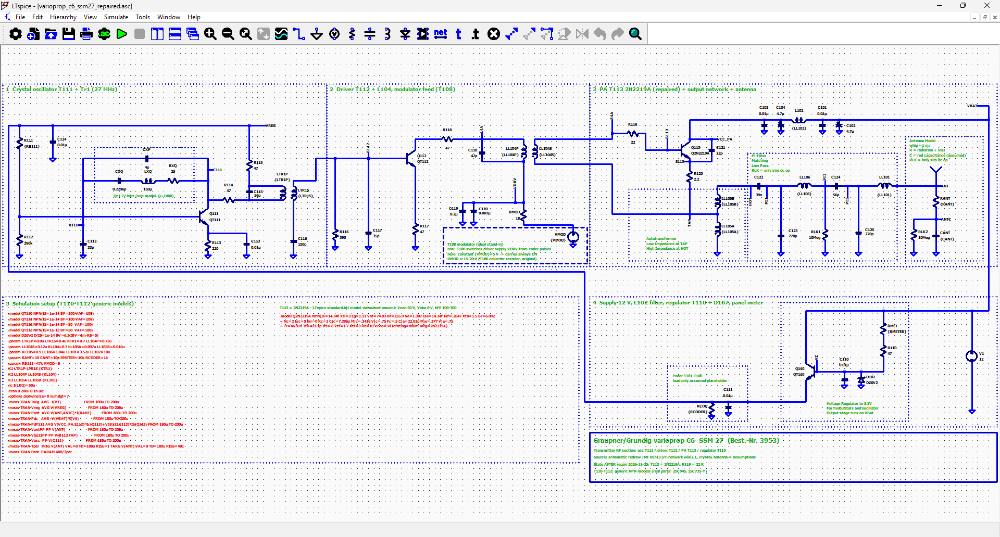
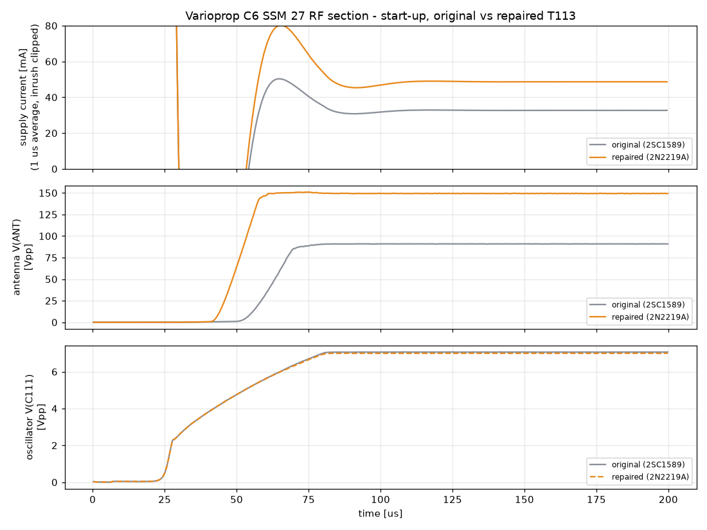
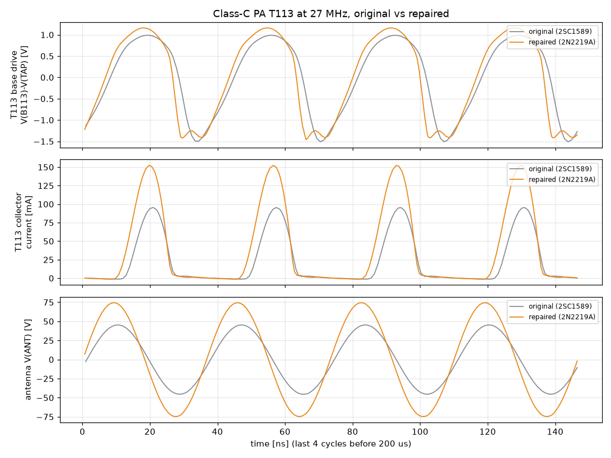

# Simulation – SSM 27 RF section

LTspice model of the transmitter RF section: regulator T110, crystal oscillator T111 + Tr1, driver T112 + L104,
class-C PA T113, pi network L105 / L106, antenna loading coil L101 and antenna.
Built from the schematic redraw (JMF 09/13, [rc-network wiki](https://wiki.rc-network.de/wiki/Graupner_Fernsteuersender_%C3%9Cbersicht#Varioprop_C6)).



## Files

| File | What |
|---|---|
| `varioprop_c6_ssm27_original.asc` | state before the repair: T113 = NEC 2SC1589 (estimated model) |
| `varioprop_c6_ssm27_repaired.asc` | state after the repair: T113 = 2N2219A (LTspice standard model) |
| `make_plots.py` | runs both files in LTspice and writes the two comparison plots |

Both files are the same circuit, only the T113 model differs. R119 = 22 Ω in both (value found on the board).

## Run

Open either `.asc` in LTspice and press Run. Nothing else needs to be installed for that.

To run both and make the plots, you need [LTspice](https://www.analog.com/ltspice) 24+ and Python 3.10+. One-time setup, in this folder (Windows PowerShell):

```
python -m venv .venv
.venv\Scripts\python -m pip install -r requirements.txt
```

Then:

```
.venv\Scripts\python make_plots.py
```

Set the environment variable `LTSPICE` to the full path of `LTspice.exe` if it is not in the default install folder (`%LOCALAPPDATA%\Programs\ADI\LTspice`).
Tested on Windows only.

## Results (180–200 µs, carrier on, 12 V)

| | original (2SC1589) | repaired (2N2219A) |
|---|---|---|
| Supply current | 33 mA | 49 mA |
| RF chain only (minus ≈ 8 mA without RF) | ≈ 25 mA | ≈ 41 mA |
| Antenna power | 30 mW | 82 mW |
| T113 dissipation | 0.25 W | 0.38 W |
| Oscillator V(C111) | 7.1 Vpp | 7.0 Vpp |
| T113 base drive | 2.5 Vpp | 2.6 Vpp |
| Frequency | 27.3 MHz | 27.3 MHz |

Bench, for comparison: 60 mA total, 10 mA with the crystal removed → **≈ 50 mA for the RF chain**.





## How far to trust it

Use the simulation to **compare original and repaired** under the same assumptions, not for absolute values.

- **Not modelled:** coder T101–T108 (a 1 kΩ load stands in), modulator T108 (constant 5 V, carrier always on), panel meter (10 kΩ).
  On the bench the carrier is keyed off in the PPM gaps, so the real average current is lower than with the carrier always on.
- **Assumed:** all inductances and coupling factors (Tr1 secondary `LTR1S = 0.4u` chosen so the PA is driven), crystal (Q lowered to ≈ 1000 for numerical reasons), antenna (10 Ω + 10 pF).
- **T110–T112** use generic NPN models (real parts: 2SC945, 2SC735-Y).
- **2SC1589** model is estimated from its ratings, see [docs/datasheets/2SC1589.md](../docs/datasheets/2SC1589.md). SPICE does not model the 4 V V_EBO breakdown that killed the original part.
- **R111** is 4.7 kΩ on the schematic; the sim uses 47 kΩ, otherwise T111 saturates and does not oscillate.
- Parameters are in the `.param` lines at the bottom left of each schematic.
